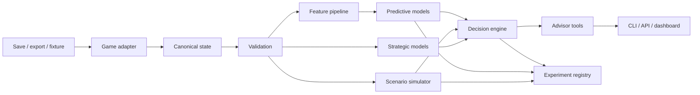

# Architecture

Source of truth: [PROJECT_CHARTER.md § System architecture](../PROJECT_CHARTER.md#system-architecture). This file tracks what is *implemented*; the charter states what is *intended*.

### Component boundaries

| Component | Responsibility | Must not do |
|---|---|---|
| Adapter | Read source format and map fields | Rank actions or infer missing critical values silently |
| Canonical schema | Represent shared concepts and game extensions | Erase game-specific semantics |
| Validator | Enforce contracts and produce quality reports | Mutate source data without provenance |
| Feature pipeline | Produce point-in-time-safe model features | Read future outcomes during inference |
| Predictor | Estimate labelled outcomes and uncertainty | Present association as causation |
| Simulator | Apply explicit transitions under seeded randomness | Use an LLM to calculate state transitions |
| Strategic model | Evaluate bargaining, coalitions, incentives, and responses | Claim a full-game equilibrium without a defined reduced game |
| Decision engine | Combine objective, forecasts, simulations, and constraints | Hide utility weights or uncertainty |
| Advisor | Call typed tools and explain returned evidence | Invent actions, mechanics, or numeric results |
| Registry | Persist manifests, metrics, and artifact lineage | Store unlicensed source content |

## Implementation status

| Component | Package | Status |
|---|---|---|
| CLI | `grand_strategy_lab.cli` | Milestone 0 stub: `version`, `smoke`; `ingest`/`validate` exit 2 |
| Canonical schema | `grand_strategy_lab.domain` | Empty — Milestone 1 |
| Adapters | `grand_strategy_lab.adapters` | Empty — Milestone 1 (fixture), Milestone 2 (EU4) |
| Validation | `grand_strategy_lab.validation` | Empty — Milestone 1 |
| Features, models, simulation, game theory, decision, agents, registry | respective packages | Empty placeholders |

## Dependency rule

`domain/` must not import pandas, Polars, any parser vendor, or any LLM SDK (charter, Milestone 1).
